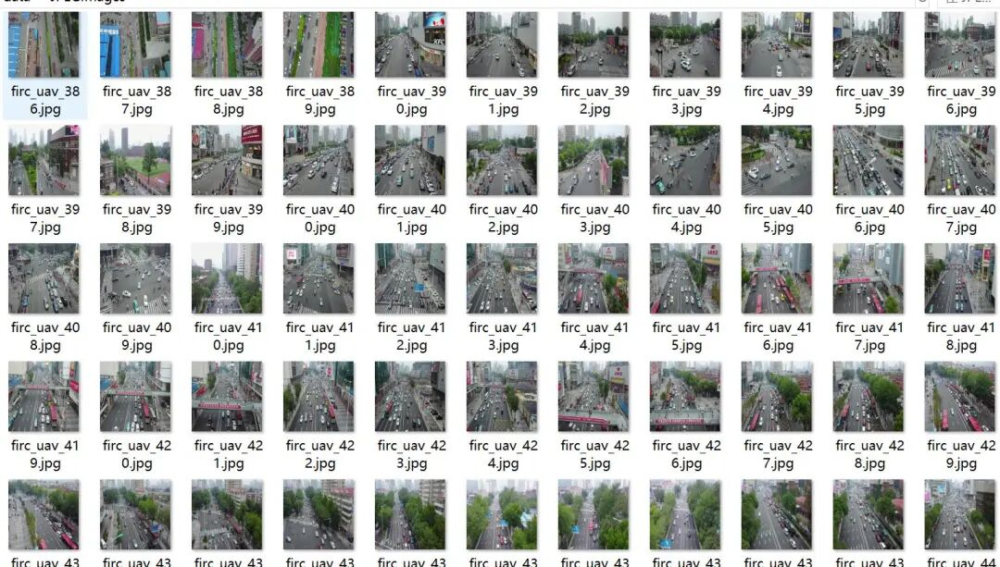
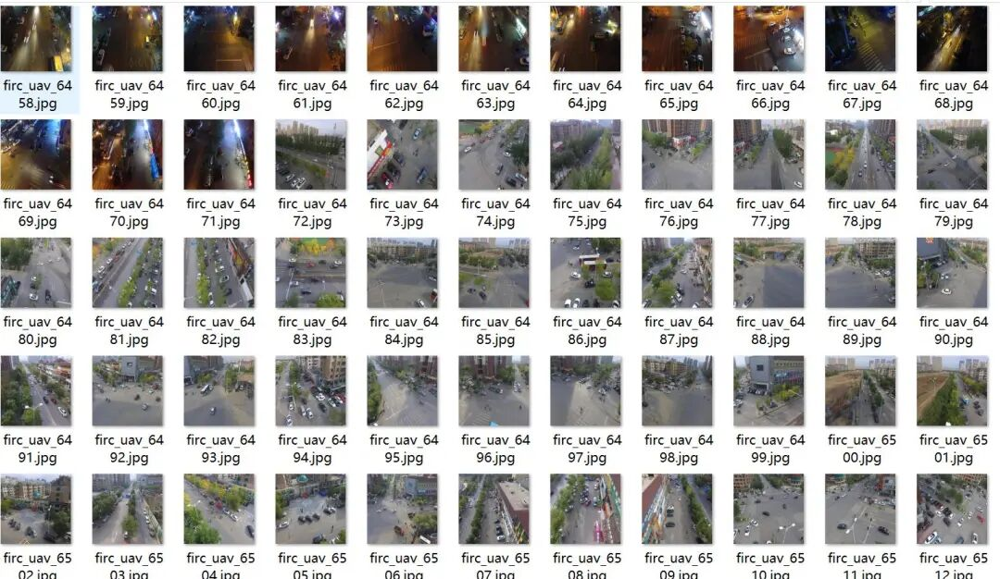
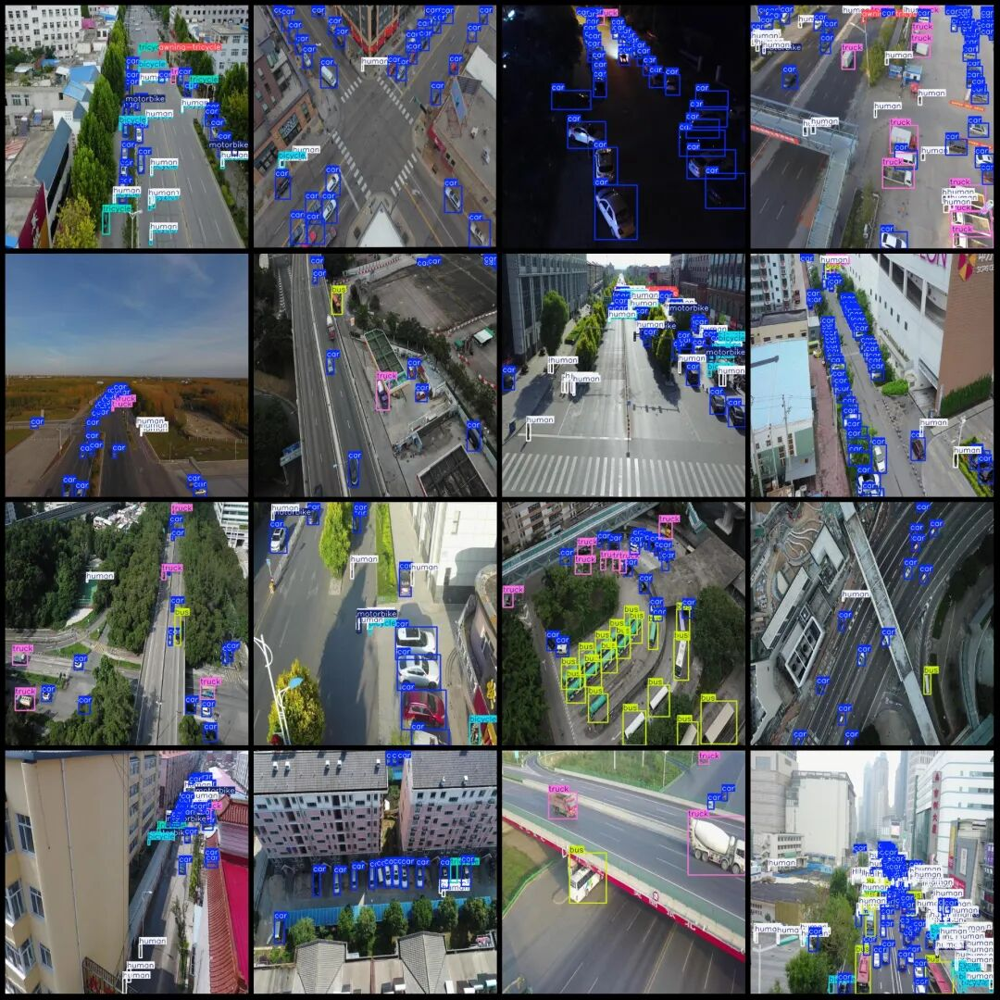

# Vehicle and Pedestrian Detection Dataset from UAV Perspective in VOC+YOLO format with 11255 categories and 8 classes

Provide  Cloud Disk address for download.

Dataset format: Pascal VOC format + YOLO format (txt file without split path, only containing jpg images and corresponding VOC format xml files and yolo format txt files)

Number of images (number of jpg files): 11255

Number of annotations (number of xml files): 11255

Number of annotations (number of txt files): 11255

Annotation Category Count: 8

Label category names (note that the order of categories in the YOLO format does not correspond to this, but is based on the labels folder's classes.txt): ["awning-tricycle", "bicycle", "bus", "car", "human", "motorbike", "tricycle", "truck"]

Number of boxes labeled in each category:

awning-tricycle frame count = 4268

Number of bicycles = 15084

Bus frame count = 9934

Car frame count = 367828

Human Frame Count = 159786

Motorbike frame count = 40122

Tricycle frame count = 6279

Truck frame count = 18615

Total frames: 621916

Using labelImg:

Annotation rules: Draw a rectangle around the category.

Important Notice: No

Image resolution: 640x640

Special : This dataset does not guarantee the accuracy of the trained models or weight files.

Image Preview:

Annotation example:

## Payment

Here is a pay link on Stripe ( https://buy.stripe.com/3cs8yP7sY87d0vu9AB ). Please contact me lonlonago@foxmail.com after funding $89, and I will send you a complete data files , thank you!

